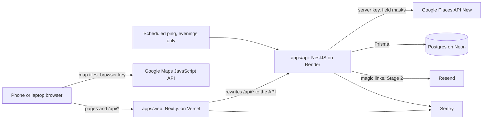

# Food finder — architecture

Status: approved · Date: 2026-10-31 · Follows [PRD.md](PRD.md) and `standards/`. Decisions are in [decisions/](decisions/).

## Pieces and request flow

`packages/shared` holds Zod schemas, API types and the chain name list, used by both apps.

**Search flow:** the browser gets your location and sends it in a POST body. The API checks the daily budget, turns
your filters into a list of Text Search calls, runs them with `openNow: true`, removes duplicates and chains, and
returns the results. Nothing about the places or your location is saved.

## The search design

This is the core of the app, and the place Kareem's learning time pays off most.

- **Text Search (New), not Nearby Search.** It has an `openNow` filter and up to 60 results across 3 pages, compared
  with 20 and no filter. See [ADR 001](decisions/001-text-search-open-now.md).
- **Pro fields only in search:** ID, name, type, location. Hours are Enterprise fields, so the list relies on the
  `openNow` filter and fetches exact hours when you open a place. This gives 5,000 free calls a month instead of 1,000.
- **A search plan per type.** Each type (food, coffee, boba, dessert) maps to a list of queries, because chains fill the
  60-result cap. At 3:22 AM, Tim Hortons took most of the 60 "coffee shop" results. Queries are tuned using real
  evening results in the tuning issue.
- **Limit per search:** at most 6 Google calls, enforced in code.
- **Chains** are removed by a normalised name match against our own list in `packages/shared`.

**Measured 2026-10-31, Saturday 3:22 AM, 5 km around Ridgeway, 6 calls:** 89 results, 88 marked open, 83 unique places.
Boardwalk Burgers and Lazeez Shawarma, listed as open past that time, appeared. Cherry's Desserts and Karachi HOTSPOT,
listed as closing at 3 AM, didn't. "restaurant" returned only 13.

**Not yet tested:** how well this works at 10 PM, when far more places are open and the cap matters most.

**Inferred, not measured:** using `openNow` with Pro fields bills as Pro. Google says billing follows requested fields.
Confirm in the Cloud Console billing report.

## Data model

Prisma models. Every table has `createdAt` and `updatedAt`. IDs are `cuid()`.

**Rule: we store Google place IDs only, never names, hours, addresses or ratings.** See
[ADR 002](decisions/002-store-place-ids-only.md).

| Entity                            | Fields                                                          | Stage |
| --------------------------------- | --------------------------------------------------------------- | ----- |
| `ApiUsageDay`                     | `id`, `day` (date, unique), `googleCalls` (int)                 | 1     |
| `User`, `Session`, `Verification` | As Better Auth generates them                                   | 2     |
| `List`                            | `id`, `userId` → User, `name`, `isFavourites` (bool)            | 2     |
| `SavedPlace`                      | `id`, `listId` → List (cascade), `googlePlaceId`                | 2     |
| `HoursCorrection`                 | `id`, `userId` → User, `googlePlaceId`, `resolvedAt` (nullable) | 2     |

Relationships: a User has many Lists, and exactly one has `isFavourites` true. A List has many SavedPlaces.

Indexes and constraints: `List.userId`, `SavedPlace.listId`, unique `(listId, googlePlaceId)`, unique
`(userId, googlePlaceId)` on HoursCorrection.

Every query for user data filters by `userId`, and tests cover it.

## API

REST, validated DTOs, OpenAPI docs. Routes need a session unless marked public.

| Method and path                           | Purpose                                                                                   | Stage | Access               |
| ----------------------------------------- | ----------------------------------------------------------------------------------------- | ----- | -------------------- |
| `GET /health`                             | API and database status                                                                   | 1     | Public               |
| `POST /places/search`                     | Body: lat, lng, radiusKm, type, cuisine, showChains. Location stays out of URLs and logs. | 1     | Public, rate limited |
| `POST /places/resolve-area`               | Turns a typed area into a location                                                        | 1     | Public, rate limited |
| `GET /places/:googlePlaceId`              | Fresh details, including hours                                                            | 1     | Public, rate limited |
| `/auth/*`                                 | Better Auth routes                                                                        | 2     | Public               |
| `GET, POST /lists`                        | Your lists                                                                                | 2     | Session              |
| `PATCH, DELETE /lists/:id`                | Rename or delete a list                                                                   | 2     | Session              |
| `GET /lists/:id/places`                   | Saved places, with fresh details                                                          | 2     | Session              |
| `POST /lists/:id/places`                  | Save a place                                                                              | 2     | Session              |
| `DELETE /lists/:id/places/:googlePlaceId` | Remove a place                                                                            | 2     | Session              |
| `GET /corrections`                        | Your flagged places and the count                                                         | 2     | Session              |
| `PUT, DELETE /corrections/:googlePlaceId` | Flag or unflag wrong hours                                                                | 2     | Session              |

`/lists/:id/places` paginates at 10 places, because each place shown costs a Place Details call.

## Screens

Every screen handles loading, empty, error and success.

| Route             | Shows                                             | You can                                                              |
| ----------------- | ------------------------------------------------- | -------------------------------------------------------------------- |
| `/`               | Open places as a list, with a Google Map          | Filter by type and cuisine, change radius, show chains, type an area |
| `/place/[id]`     | Name, type, today's hours, closing time, distance | Open in Google Maps. In Stage 2: save, flag wrong hours              |
| `/sign-in` (2)    | Email field                                       | Get a magic link                                                     |
| `/lists` (2)      | Your lists                                        | Create, rename, delete                                               |
| `/lists/[id]` (2) | Saved places with open or closed status           | Remove a place                                                       |

Places Data needs Google attribution, and the Google logo wherever it's shown without a Google Map.

## Services

| Need        | Choice                  | Free limit                                                    | Note                                                                                                                  |
| ----------- | ----------------------- | ------------------------------------------------------------- | --------------------------------------------------------------------------------------------------------------------- |
| Web hosting | Vercel                  | Hobby plan (limits not rechecked)                             | Preview deploy per PR                                                                                                 |
| API hosting | Render                  | 750 hours a month, sleeps after 15 min, about 1 min to wake   | See [ADR 005](decisions/005-keep-api-awake.md)                                                                        |
| Database    | Neon                    | 0.5 GB. Compute 50 or 100 hours (Neon's docs disagree)        | Not Render Postgres, which expires after 30 days                                                                      |
| Auth        | Better Auth, magic link | Open source                                                   | Limited to Kareem's email                                                                                             |
| Email       | Resend                  | 3,000 a month, 100 a day                                      | From memory: without your own domain it only sends to the account owner, which suits one user. Confirm in that issue. |
| Places      | Google Places (New)     | Text Search Pro and Place Details Pro 5,000, Enterprise 1,000 | Then $17–35 per 1,000                                                                                                 |
| Map         | Google Maps JavaScript  | 10,000 map loads a month                                      | Separate key locked to our web addresses                                                                              |
| Errors      | Sentry                  | 5,000 errors a month, 1 user                                  |                                                                                                                       |

Local development uses Docker Postgres only when needed, or a Neon branch, to stay light on 8 GB machines.

**Environments:** local, staging (Vercel preview, a second Render service, a Neon branch, a separate Google key) and
production. Each has its own database and keys.

## Changes to the PRD's assumptions

- **Caching.** Google doesn't allow caching Places content, so the learning milestone's caching work applies only to our
  own data, like lists. The load test and scaling work still stand.
- **Background job.** A job that refreshes place data would break the no-pre-fetch rule, so that service split is out.
- **Map.** Must be a Google Map. This is settled, not an open question.
